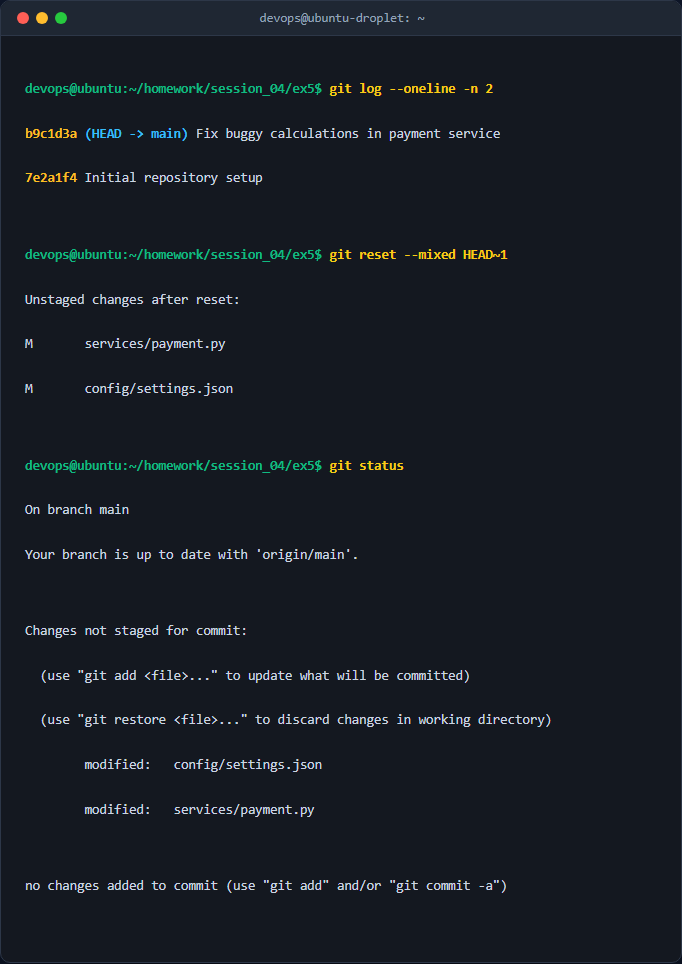
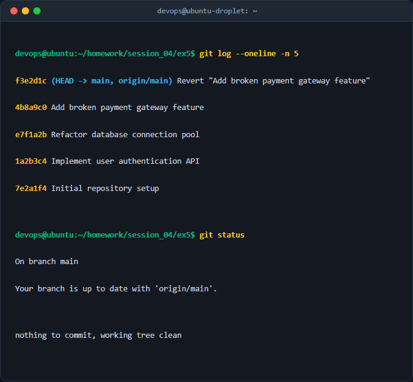

# Bài 5: Khôi phục trạng thái và Đảo ngược commit (Reset vs Revert)

## 1. Mục tiêu & Bối cảnh kỹ thuật

### Mục tiêu
- Thực hành thành thạo hai cơ chế quản lý lịch sử commit trong Git: `git reset` và `git revert`.
- Hiểu rõ sự khác biệt giữa xử lý lỗi ở môi trường cục bộ (local branch) và môi trường làm việc nhóm (public/shared branch).
- Đảm bảo an toàn mã nguồn, không làm mất dữ liệu quan trọng trong quá trình khôi phục trạng thái project.

### Bối cảnh kỹ thuật
Trong quá trình phát triển phần mềm, lập trình viên thường gặp phải các tình huống cần sửa lỗi lịch sử:
- **Trường hợp 1 (Local):** Phát hiện commit vừa tạo ở local chứa đoạn mã bị lỗi logic hoặc chưa hoàn thiện. Yêu cầu lùi con trỏ `HEAD` lại 1 commit, giữ nguyên các thay đổi trong Working Directory dưới dạng chưa chuẩn bị (unstaged / modified) để tiếp tục chỉnh sửa.
- **Trường hợp 2 (Public):** Một commit lỗi đã được đẩy lên nhánh chung (`main`/`develop`) hoặc thuộc lịch sử cũ. Cần hủy bỏ ảnh hưởng của commit đó một cách an toàn bằng cách tạo một commit mới đối lập (Revert commit) mà không làm thay đổi hay phá vỡ lịch sử commit hiện có của nhóm.

---

## 2. Các bước thực hiện chi tiết

### Trường hợp 1: Khôi phục cục bộ bằng `git reset` (Mixed Mode)

#### Bước 1: Kiểm tra lịch sử commit và trạng thái hiện tại
Xem lịch sử commit gần nhất để xác định vị trí `HEAD`:
```bash
git log --oneline -n 3
```
*Giải thích parameter:*  
- `--oneline`: Hiển thị mỗi commit trên một dòng gọn nhẹ (mã hash ngắn + commit message).  
- `-n 3`: Giới hạn danh sách chỉ hiển thị 3 commit gần nhất.

#### Bước 2: Thực hiện `git reset` không phá hủy mã nguồn
Thực hiện di chuyển `HEAD` lùi lại 1 commit, giữ toàn bộ mã thay đổi ở Working Directory:
```bash
git reset --mixed HEAD~1
```
*Giải thích câu lệnh & cờ tham số:*  
- `git reset`: Lệnh di chuyển con trỏ nhánh và `HEAD` về một mốc commit chỉ định.  
- `--mixed` (Chế độ mặc định): Hủy bỏ commit và tháo các file khỏi Index (Staging Area), đưa toàn bộ thay đổi về Working Directory ở trạng thái chưa được stage (`modified`). Đảm bảo tuyệt đối không mất code.  
- `HEAD~1`: Chỉ định mốc commit ngay trước commit hiện tại (lùi lại 1 bước).

#### Bước 3: Kiểm tra trạng thái làm việc (Working Directory)
```bash
git status
```
*Mục đích:* Xác nhận các file từ commit bị hủy đã quay trở lại Working Directory dưới dạng `Changes not staged for commit` (màu đỏ).

---

### Trường hợp 2: Đảo ngược công cộng bằng `git revert`

#### Bước 1: Xác định mã Hash của commit cần đảo ngược
```bash
git log --oneline -n 5
```
*Ví dụ output:*  
`a8f1b2c (HEAD -> main) Add feature broken auth system`  
Mã commit cần hủy là `a8f1b2c`.

#### Bước 2: Thực hiện lệnh `git revert`
```bash
git revert a8f1b2c --no-edit
```
*Giải thích câu lệnh & cờ tham số:*  
- `git revert <commit_hash>`: Tạo ra một commit mới chứa các thay đổi đảo ngược hoàn toàn (inverse changes) so với commit được chỉ định. Lịch sử cũ giữ nguyên tuyệt đối.  
- `--no-edit`: Cho phép Git sử dụng thông điệp commit mặc định (`Revert "Add feature broken auth system"`) mà không cần mở trình biên soạn văn bản (Vim/Nano).

#### Bước 3: Kiểm tra lịch sử sau khi Revert
```bash
git log --oneline -n 5
```
*Mục đích:* Xác nhận commit mới có tiêu đề `Revert ...` xuất hiện trên cùng của lịch sử commit.

---

## 3. Kiểm tra & Xác thực kết quả

### Xác thực Trường hợp 1 (Reset Mixed)
Trạng thái Working Directory sau khi chạy `git reset --mixed HEAD~1`:



### Xác thực Trường hợp 2 (Revert Commit)
Lịch sử commit sau khi thực hiện thành công lệnh `git revert`:



---

## 4. Kết luận & Best Practices bảo mật vận hành

### Bảng so sánh tổng quan: Reset vs Revert

| Đặc tính | `git reset` | `git revert` |
| :--- | :--- | :--- |
| **Cơ chế hoạt động** | Di chuyển con trỏ `HEAD` lùi lại lịch sử, loại bỏ hoặc thay đổi trạng thái các commit phía trước. | Tạo một commit mới chứa mã đảo ngược (patch ngược) của commit chỉ định. |
| **Thay đổi lịch sử** | Làm thay đổi/viết lại lịch sử Git (Rewriting History). | Giữ nguyên lịch sử cũ, chỉ thêm commit mới vào chuỗi lịch sử. |
| **Phạm vi sử dụng** | **Chỉ dùng cho Local Branch** (chưa push lên remote server). | **An toàn cho Remote / Public Branch** (đã push lên nhánh dùng chung). |
| **Mức độ an toàn** | Có rủi ro mất code nếu dùng `--hard`. Gây lỗi xung đột nghiêm trọng nếu đã push. | An toàn tuyệt đối, không gây xung đột lịch sử đối với các thành viên khác trong team. |

### Best Practices khi vận hành Git trong dự án lớn

1. **Tuyệt đối KHÔNG sử dụng `git reset --hard` trên các nhánh dùng chung (`main`, `staging`, `develop`):**  
   Sử dụng reset trên remote branch sẽ làm lệch lịch sử commit (`diverged branch`), buộc người dùng phải `git push --force`. Điều này có thể ghi đè và làm mất mã nguồn công sức của các thành viên khác.
2. **Luôn ưu tiên `git revert` cho commit đã push:**  
   Trong môi trường sản xuất (Production) hoặc làm việc nhóm, mọi thao tác sửa lỗi lịch sử công khai bắt buộc phải dùng `git revert` để đảm bảo tính minh bạch và truy vết audit log đầy đủ.
3. **Cấu hình Branch Protection Rules trên GitHub/GitLab:**  
   Bật tính năng cấm `force push` (`Require linear history` hoặc `Block force pushes`) đối với nhánh `main`/`master` để ngăn ngừa rủi ro thao tác sai từ phía kỹ sư.